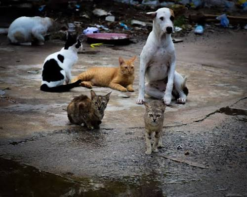
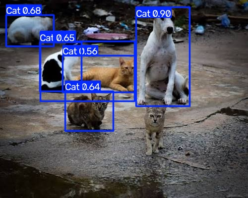

# Atividade comparando YOLO8 com YOLO26
## Requisitos
A biblioteca *ultralytics* precisa está instalada. 
A biblioteca *huggingface_hub* é necessária para treinar IA.
## Imagens
Imagem original 

resultado do YOLO8 

resultado do YOLO26 

resultado YOLO26 treinado 

